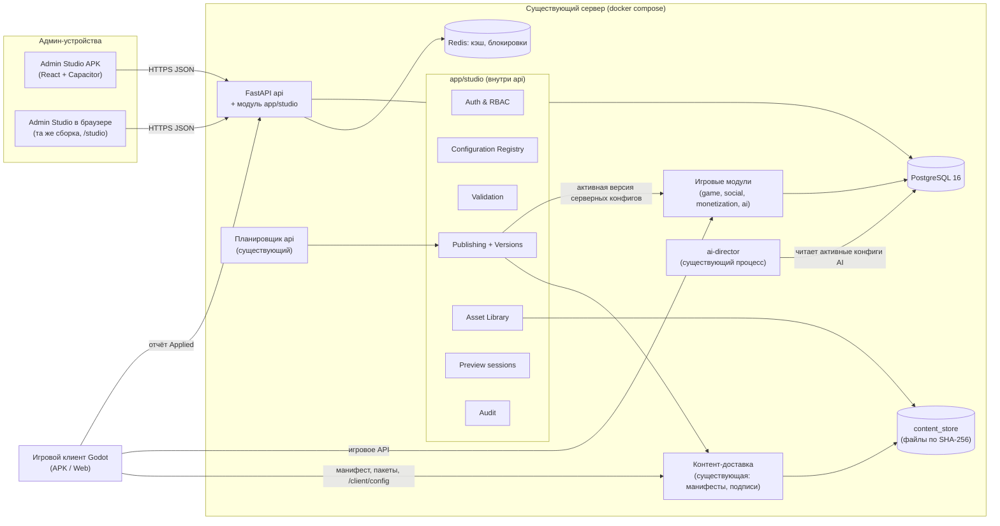
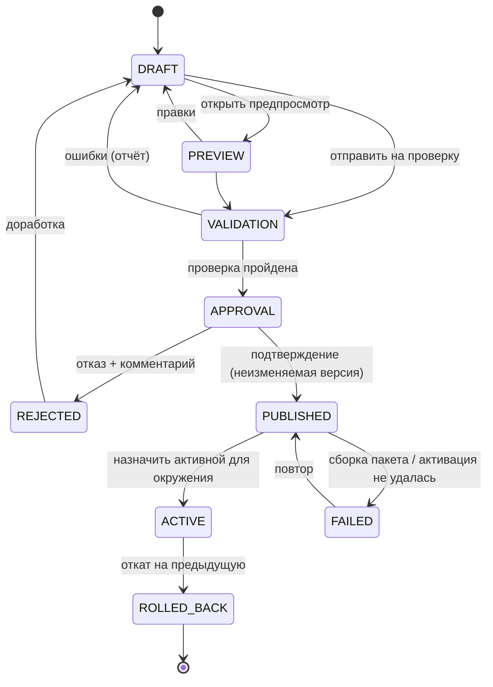
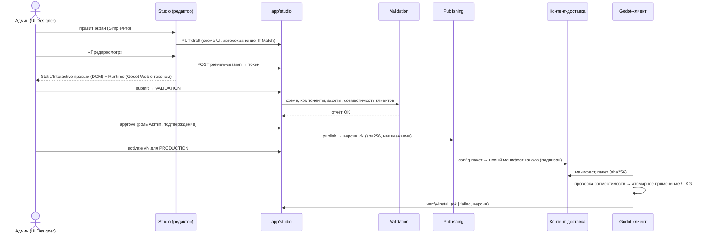

# Архитектура URALIA ADMIN STUDIO [Предложение]

## 1. Принципы

1. **Эволюция, не переписывание.** Studio встраивается в существующий монолит FastAPI как модуль `app/studio/`;
   существующие механизмы (контент-пакеты, подписи, каналы, `game_overrides`, Section-история AI) становятся
   «адаптерами» реестра, а не выбрасываются. [Основано на коде: AUDIT §3–4]
2. **Одна модель данных.** Любая настройка — версия конфигурации в Configuration Registry, у которой есть схема.
   Simple и Pro режимы редактора, формы и импорт работают с ней же.
3. **Контролируемое применение.** DRAFT → PREVIEW → VALIDATION → APPROVAL → PUBLISHED → ACTIVE (+ REJECTED, FAILED,
   ROLLED_BACK). Published ≠ Active ≠ Applied.
4. **Данные, а не код.** Никакого удалённого GDScript/SQL/shell. Клиент получает только данные (JSON, ассеты),
   которые интерпретирует фиксированным, проверенным кодом.
5. **Безопасный отказ.** Сервер и клиент всегда имеют «последнюю рабочую» версию; несовместимое не применяется.
6. **Бережно к VPS.** Без новых постоянных процессов: работа — в `api` и существующем планировщике.

## 2. Общая схема

## 3. Два класса конфигураций

| Класс | Где действует | Как доставляется | Applied |
|---|---|---|---|
| **Серверные** (баланс, экономика, награды, расписания, AI, PvP, магазин) | Игровые модули сервера | Активация версии в реестре → сервер читает активную версию (кэш в процессе + версия в Redis) | Подтверждается самим сервером (health конфигов) |
| **Клиентские** (UI, тема, иконки, ассеты, тексты, клиентские флаги) | Godot-клиент | Сборка **конфиг-пакета** (новый kind `config`) → существующий подписанный манифест канала | Клиент сообщает через `verify-install` (уже есть) + новое поле версии бандла |

Это разделение основано на коде: бой и экономика серверно-авторитетны (`battle_sim.py`, кошельки на сервере),
клиент получает только данные отображения.

## 4. Жизненный цикл конфигурации

## 5. Поток изменения интерфейса игры

## 6. Где живёт каждый компонент

| Компонент | Место | Обоснование |
|---|---|---|
| Admin Studio UI | Новый фронтенд `studio/` (React), статика через FastAPI `/studio`, APK через Capacitor | Одна кодовая база |
| Admin API, Auth, Registry, Validation, Publishing, Versions, Audit, Preview, Assets | **Внутри** `server/app/studio/` (модуль монолита) | Не плодим сервисы на 2 ГБ RAM |
| Контент-доставка | Существующий `app/content/` | Уже есть подписи и атомарность |
| Фоновые задачи (сборка пакетов, проверка ассетов, очистка) | Существующий планировщик `social/scheduler.py` + таблица задач Studio | Нет нового процесса |
| Runtime Preview | Игровой клиент Godot (Web-экспорт `/play` и/или Android-клиент) в режиме preview | Настоящий интерфейс |
| Применение конфигов в клиенте | Новый автозагрузчик `ConfigClient` (на основе `Content`) | Атомарность и LKG уже есть в `Content` |
| Мониторинг | Раздел Studio поверх существующих данных (`job_runs`, `content_installations`, `/health`) | Без внешних систем на старте |

## 7. Ключевые архитектурные решения (кратко)

| ID | Решение | Документ |
|---|---|---|
| AS-01 | React+TS+Capacitor, Godot для Runtime Preview | TECHNOLOGY_SELECTION |
| AS-02 | Модуль `app/studio` внутри монолита; без микросервисов | SYSTEM_COMPONENTS |
| AS-03 | Configuration Registry с модулями-владельцами и JSON Schema | CONFIGURATION_SYSTEM |
| AS-04 | Клиентские конфиги — через существующие подписанные манифесты (kind `config`) | GODOT_INTEGRATION |
| AS-05 | UI-схема из разрешённых компонентов, интерпретируемая `UIRuntime` в Godot; перенос экранов по одному | UI_EDITOR_ARCHITECTURE |
| AS-06 | Пользователи-админы, роли, сессии; старый токен — аварийный вход Super Admin | SECURITY_MODEL |
| AS-07 | Окружения = каналы контента + область активации серверных конфигов | ENVIRONMENTS_AND_RELEASES |
| AS-08 | Неизменяемые версии, оптимистические блокировки (ETag/If-Match), идемпотентная публикация | VERSION_MANAGEMENT |
