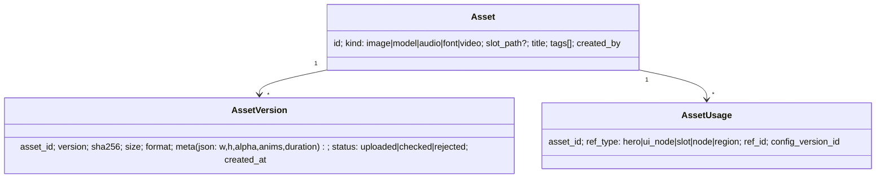
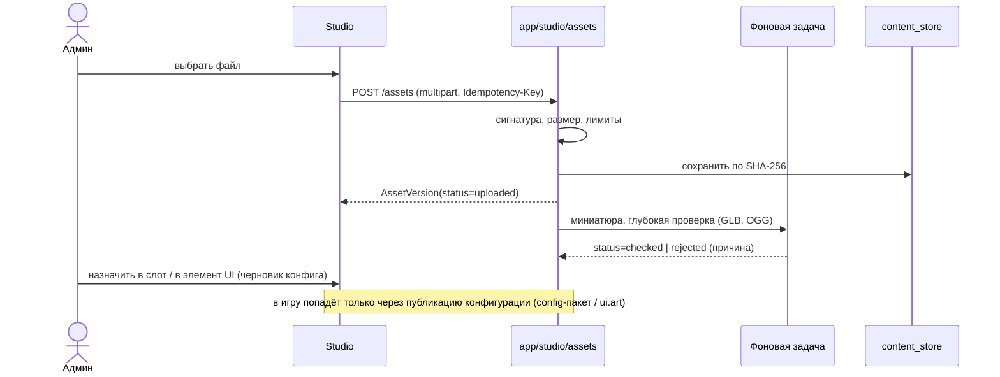

# Медиатека (Asset Management)

## 1. Что есть сейчас [Код]

- Слоты «Графики» (`server/app/admin_web/art.py`): фиксированный каталог путей (иконки, кнопки, панели, герои,
  карты, 3D-модели героев, 3D-карты регионов и сцены боя). Каждый слот описан: размер, нужен ли прозрачный фон,
  «где в игре», промпт для генерации.
- Проверки: PNG/JPEG по заголовку (`image_size`), WEBP отклоняется, JPEG запрещён там, где нужна прозрачность,
  до 8 МБ; GLB — разбор glTF-заголовка (`glb_info`: анимации, скелет), до 40 МБ, маппинг анимаций и масштаб.
- Черновое хранилище `content_store/art_staging` + `index.json`; «Опубликовать» собирает пакеты `ui.art` и
  `ui.models3d` → подписанный манифест (`content/service.py`), файлы хранятся по SHA-256 (`content/store.py`).
- ZIP-патчи могут класть файлы в слоты (тип `art`), с откатом (`game_editor/patches.py`).
- Нет: тегов, поиска, версий ассета (кроме истории манифестов), связей «ассет ↔ объекты», поиска неиспользуемых,
  звуков/шрифтов в админке, миниатюр.

## 2. Модель [Предложение]

- Файлы — в существующем хранилище по SHA-256 (дедупликация бесплатно). Новая версия ассета = новая строка,
  старые не удаляются, пока на них ссылается хоть одна опубликованная версия конфигурации.
- Слот (`ui/home_bg.png`) — частный случай ассета с фиксированным `slot_path`; свободные ассеты (для Pro-редактора
  UI: фон панели, картинка в карточке) получают путь `art/lib/<asset_id>.<ext>`.

## 3. Форматы и ограничения

| Тип | Форматы | Лимит | Проверки |
|---|---|---|---|
| Изображения | PNG, JPEG (WebP — после проверки поддержки в клиенте: `Content.ALLOWED` уже содержит webp [Код], админка пока отклоняет) | 8 МБ, ≤ 4096 px по стороне | заголовок, размеры по слоту, альфа, «бомба распаковки» (w×h×4 ≤ 64 МБ) |
| SVG | **нет** — Godot импортирует SVG только при сборке; в рантайме не поддерживаем, конвертация на сервере в PNG — позже | — | — |
| 3D | GLB (glTF 2.0 binary) | 40 МБ | заголовок, JSON-чанк, число вершин/текстур (предупреждение > 60k треугольников для телефонов), анимации |
| Звук | OGG Vorbis (клиент: `AudioStreamOggVorbis` [Код]) | 5 МБ, ≤ 3 мин | заголовок OggS, длительность |
| Шрифты | TTF/OTF | 4 МБ | заголовок; только из разрешённых гарнитур темы |
| Видео | не планируется (нет плеера в клиенте) | — | — |

Безопасность: проверка сигнатур, а не расширений; имена файлов генерирует сервер; ZIP-архивы — те же лимиты, что у
патчей; никаких исполняемых форматов; EXIF не нужен — метаданные отбрасываются при перекодировании миниатюр.

## 4. Функции

Загрузка (одиночная, пакетная, ZIP), просмотр (миниатюры генерирует сервер фоновой задачей — Pillow; для GLB —
`model-viewer` на клиенте), категории = разделы слотов + теги, поиск (по названию, тегу, пути), замена (новая
версия), сравнение версий (рядом), проверка совместимости (размер слота, клиентская поддержка формата по
`min_client`), связи (`AssetUsage` заполняется при публикации конфигураций), **неиспользуемые** = нет связей в
активных версиях → предложение архивировать (физическое удаление — только Super Admin, и только без ссылок).

## 5. Поток загрузки ресурса

