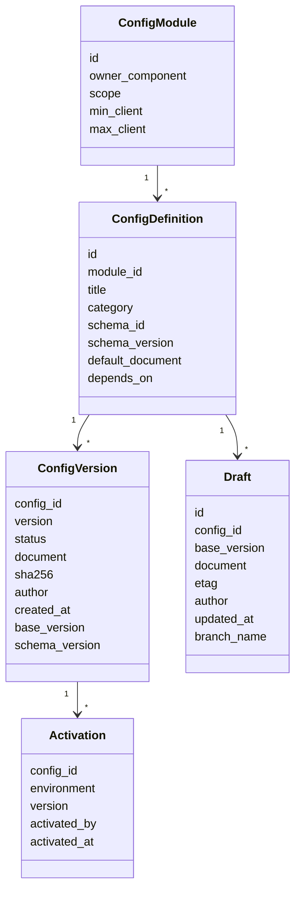

# Configuration System и Configuration Registry [Предложение]

## 1. Проблема [Код]

Сегодня настройки лежат в коде (`game/data.py`), JSON-файлах (`game/content/*.json`), ~20 ключах `server_settings`
с разными форматами истории и в слое `game_overrides`. Изменение одного раздела может перезаписать JSON целиком
(пример: `server_settings["game_overrides"]` хранит герои, регионы, этапы и карту в одном документе).

## 2. Модель



Каждая конфигурация имеет (требование ТЗ → поле): ID → `config_id`; название → `title`; категория → `category`;
версия → `version`; статус → `status`; дата → `created_at/updated_at`; автор → `author_id`; схема →
`schema_id@schema_version`; содержимое → `document`; зависимости → `depends_on`; контрольная сумма → `sha256`
(от канонического JSON — уже есть `core/signing.canonical`).

## 3. Модули и гранулярность

Один **модуль** = один владелец в коде. Конфигурации — мелкие документы внутри модуля, а не один большой JSON.

| Модуль | Примеры config_id | Владелец (код) [Код] |
|---|---|---|
| `economy` | `economy.starting_wallet`, `economy.building_costs`, `economy.stage_rewards` | `game/data.py`, `services.py` |
| `heroes` | `heroes.catalog` (коллекция), `heroes.rarity_mult`, `heroes.stars` | `game_editor/overrides.py`, `data.py` |
| `combat` | `combat.coefficients`, `combat.skill_kits` (коллекция) | `game/battle_sim.py`, `roster.json` |
| `campaign` | `campaign.regions`, `campaign.nodes`, `campaign.world_map` | `game_editor/campaign.py` |
| `summon` | `summon.pools`, `summon.pity` | `data.py` SUMMON_POOLS |
| `social` | `social.arena`, `social.tournaments`, `social.chat`, `social.events` | `game/content/social.json` |
| `shop` | `shop.products` (коллекция), `shop.vip`, `shop.battlepass` | `monetization/*`, `shop_products` |
| `ai` | `ai.director`, `ai.speech`, `ai.tiers`, `ai.memory`, `ai.outreach`… | `ai/sections.py` (Section) |
| `flags` | `flags.features`, `flags.experiments` | новое |
| `ui` | `ui.theme`, `ui.screens.home`, `ui.screens.more`, `ui.nav` | `game_editor/layout.py` (v1), клиент |
| `l10n` | `l10n.ru`, `l10n.en` | новое |

Правило изоляции: **запись разрешена только в один config_id за раз**; изменение нескольких конфигов —
это **changeset** (набор версий), который проходит валидацию и публикуется атомарно. Перезаписать чужой модуль
невозможно: API принимает `config_id` и проверяет схему именно этого конфига.

## 4. Схемы

- JSON Schema 2020-12, хранятся в коде сервера (`app/studio/schemas/<module>/<config>.v<N>.json`) — источник истины
  вместе с кодом, который их читает. Studio получает схемы через API и строит формы.
- Расширения схемы URALIA (`x-uralia-*`): `x-uralia-ref` (ссылка на сущность: `hero`, `asset`, `node`…),
  `x-uralia-unit` (сек, %, золото), `x-uralia-widget` (slider, color, icon-picker), `x-uralia-danger`
  (изменение требует подтверждения), `x-uralia-client` (поле уходит в клиентский пакет).
- Значения по умолчанию — `default` в схеме + `default_document` (то, что сейчас захардкожено, переносится 1:1,
  поэтому «пустой реестр» = текущее поведение игры).

## 5. Частичные и полные обновления

- Полное: `PUT /drafts/{id}` с документом.
- Частичное: `PATCH /drafts/{id}` с JSON Patch (RFC 6902) — для правок одного поля с телефона.
- Коллекции (герои, товары, этапы): элемент — отдельная запись с ключом, частичные правки по ключу.
- Каждое обновление черновика — с `If-Match: <etag>`; несовпадение → 409 + текущая версия для слияния.

## 6. Валидация (уровни)

1. Схема и типы. 2. Диапазоны и инварианты (сумма шансов = 100 %). 3. Ссылки (`x-uralia-ref` существует и не
отключён). 4. Зависимости между конфигами (`depends_on`: пул призыва зависит от каталога героев). 5. Совместимость
клиентов (клиентские поля поддерживаются `min_client`). 6. Ассеты (есть, формат, размер). 7. UI (компоненты из
каталога, обязательные элементы). 8. Бизнес-проверки модуля (отчёт баланса, прогноз экономики). Ошибка →
блокирует; предупреждение → требует подтверждения при APPROVAL.

## 7. Совместимость версий

- `schema_version` у каждой версии; сервер умеет читать текущую и предыдущую (миграция документа на чтении).
- Клиентские конфиги несут `min_client` / `max_client`; Publishing собирает пакет с `min_client_version`
  (поле уже есть в формате пакета [Код: `content/pack.py`]).

## 8. Чтение конфигов игровыми модулями

```python
# [Предложение] интерфейс для игрового кода
cfg = registry.active("economy.starting_wallet", env)   # кэш процесса; инвалидация по версии в Redis
```
Кэш: словарь в процессе + ключ `cfg:ver:<env>` в Redis (номер активной публикации). При активации
номер увеличивается → процессы `api` и `ai-director` перечитывают затронутые конфиги. Без Redis — проверка
по таймеру (30 с) из БД.

## 9. Миграция существующих настроек (адаптеры)

| Сейчас | В реестре | Как |
|---|---|---|
| `ai/sections.py` Section (история, откат) | `ai.*` | Section читает активную версию реестра; история переносится как версии |
| `game_overrides` | `heroes.*`, `campaign.*` | разрезается на конфиги по сущностям; `apply_admin_layer` остаётся механизмом применения |
| `ui_layout` | `ui.nav`, `ui.screens.home`, `ui.screens.more` | 1:1, схема из `layout.validate` |
| `game/content/*.json` | `social.*`, `shop.*`, `heroes.roster` | файл = `default_document`, правки — версии в БД |
| константы `data.py` | `economy.*`, `summon.*`, `heroes.stars` | вынос в `default_document` без изменения значений |

Переход постепенный: модуль за модулем, старая админка продолжает работать для неперенесённых.

## 10. Импорт ZIP-патчей (уже реализовано в текущей админке)

Запрос владельца (2026-11-02): любая настройка меняется и вручную, и ZIP-патчем, который может подготовить внешний ИИ
по заданию-шаблону. Реализация v1 — `docs/PATCHES.md`, `server/app/game_editor/patches.py` (формат `uralia-patch/1`,
проверка без записи, применение «всё или ничего», откат последнего патча, задания для ИИ по каждой настройке).
В Admin Studio [Предложение]: патч = **changeset** реестра. Загрузка создаёт черновики затронутых конфигураций, дальше
обычный путь PREVIEW → VALIDATION → APPROVAL → PUBLISHED → ACTIVE. Задания для ИИ строятся из JSON Schema
конфигурации (`x-uralia-*` даёт допустимые значения), формат меняется на `uralia-patch/2` с `config_id` и
`base_version` (защита от устаревших патчей: 409, если конфиг изменился после выгрузки шаблона).
