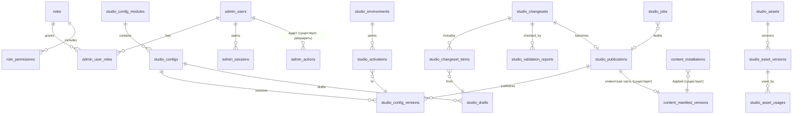

# Проект базы данных [Предложение, основано на существующей схеме]

## 1. Что уже есть и переиспользуется [Код: `server/app/models.py`]

| Сущность ТЗ | Существующая таблица | Решение |
|---|---|---|
| Admin Users, Roles, Permissions | — (общий токен) | **новые** таблицы |
| Configurations / Versions / Drafts / Publications | разрозненно: `server_settings` (+ `*_history` ключи) | **новые** таблицы реестра; `server_settings` остаётся для служебного (статусы Director и т.п.) |
| Environments | каналы как строки в `content_manifest_versions.channel` | **новая** маленькая таблица окружений, ссылающаяся на канал |
| Assets / Asset Versions | `content_package_versions` (пакеты), `art_staging/index.json` (файл, не БД) | **новые** `studio_assets`, `studio_asset_versions`; бинарники — в существующем `content_store` |
| UI Screens / UI Components | `server_settings["ui_layout"]` | UI-документы — это конфиги модуля `ui` (отдельных таблиц экранов не нужно); каталог компонентов — в коде |
| Validation Reports | — | **новая** |
| Audit Events | `admin_actions` (admin — строка, без до/после) | **расширить** (миграция добавляет `admin_user_id`, `ip`, `device`, `before_sha`, `after_sha`, `object_type`, `object_id`); старые записи остаются |
| Client Applications | — (версия клиента не хранится) | **новая** лёгкая таблица (агрегат по версиям) |
| Client Applied Versions | `content_installations` (user, manifest_version, channel, status, details) | **переиспользовать**: добавить `config_set_version` и `client_version` |

## 2. ER-диаграмма (новые таблицы и связи с существующими)

## 3. Описание новых таблиц

| Таблица | Ключевые поля | Примечания |
|---|---|---|
| `admin_users` | id uuid, login unique, password_hash, totp_secret_enc, status, created_at, last_login_at | Секрет TOTP шифруется ключом из env |
| `roles` / `role_permissions` / `admin_user_roles` | role code; permission string `module:action[:env]` | Предзаполнение ролями из SECURITY §3 |
| `admin_sessions` | id, admin_user_id, refresh_hash, device, ip, created_at, expires_at, revoked_at | Ротация refresh |
| `studio_config_modules` | id ("economy"), scope server/client/both, title | Заполняются из кода (миграция данных) |
| `studio_configs` | id ("economy.starting_wallet"), module_id, title, category A–D, schema_id, schema_version, depends_on json | Определения |
| `studio_config_versions` | (config_id, version) PK, document json, sha256, schema_version, status, author_id, created_at, publication_id | **Только INSERT** (триггер) |
| `studio_drafts` | id, config_id, branch, base_version, document json, etag, author_id, updated_at, status | Автосохранение |
| `studio_changesets` | id, title, description, source (manual/zip_patch/ai), status (DRAFT…ROLLED_BACK), author_id, approver_id, environment, comment, idempotency_key | Жизненный цикл |
| `studio_changeset_items` | changeset_id, draft_id, config_id | Состав |
| `studio_validation_reports` | id, changeset_id, ok, errors json, warnings json, created_at | История проверок |
| `studio_publications` | id, changeset_id unique, created_at, created_by, sha256, client_package_version?, manifest_version_id? | Неизменяемая |
| `studio_environments` | id ("development"/"staging"/"production"), content_channel ("dev"/"test"/"stable"), protected bool | |
| `studio_activations` | id, environment_id, config_id, version, activated_by, activated_at, reason, rollback_of? | Последняя строка = активная |
| `studio_assets` / `studio_asset_versions` / `studio_asset_usages` | см. ASSET_MANAGEMENT | sha256 → `content_store` |
| `studio_jobs` | id, kind, payload json, status, attempts, lease_until, result json, error | Как `ai_tasks` [Код] |
| `client_versions_seen` | client_version, platform, channel, last_seen_at, players | Агрегат для мониторинга совместимости |

## 4. Миграции

Только аддитивные (как требуют RULES): новые таблицы + новые nullable-колонки в `admin_actions` и
`content_installations`. Перенос существующих настроек в реестр — миграцией данных, **без удаления** старых ключей
`server_settings` (они остаются резервом до подтверждения переноса модуля). Номер следующей миграции — `0017`
(текущая голова `0016` [Код]).

## 5. Объёмы

Конфиги: сотни документов по 1–60 КБ → единицы МБ даже с тысячами версий. Аудит: ~10³–10⁴ строк/мес. Ассеты: в
файловом хранилище (сотни МБ), в БД — только метаданные. Нагрузка на PostgreSQL незначительна по сравнению с игровыми
таблицами.
