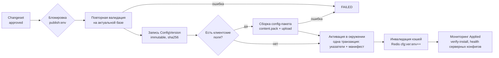

# Черновики, проверка и публикация [Предложение]

Сейчас [Код]: правки в админке действуют сразу (кроме графики, которая публикуется кнопкой), ZIP-патчи — с проверкой
без записи и откатом последнего. Admin Studio вводит полный управляемый цикл.

## 1. Состояния

| Состояние | Кто переводит | Что происходит | Обратимо |
|---|---|---|---|
| DRAFT | автор | правки, автосохранение (If-Match), несколько черновиков на конфиг (ветки) | да |
| PREVIEW | автор | Static/Interactive/Runtime предпросмотр, сравнение с активной версией | — (не состояние БД, а действие над DRAFT) |
| VALIDATION | автор («Отправить») | сервер строит ValidationReport (CONFIGURATION_SYSTEM §6); ошибки → обратно в DRAFT | да |
| APPROVAL | роль с правом `approve` | список изменений (diff), предупреждения, выбор окружения, комментарий | — |
| REJECTED | утверждающий | отказ с обязательным комментарием | → DRAFT |
| PUBLISHED | утверждающий | неизменяемые ConfigVersion, sha256, changeset закрыт, запись в истории; для клиентских — сборка config-пакета | нет (только новая версия) |
| ACTIVE | роль `activate:<env>` | указатель окружения → версия; сервер перечитывает, клиенты получают манифест | откат = активация другой версии |
| FAILED | система | сборка пакета/активация не удалась (причина в отчёте) | повтор |
| ROLLED_BACK | роль `rollback:<env>` | активной становится предыдущая версия; текущая помечается | да |

Правило «четырёх глаз» для PRODUCTION [Предложение]: автор не может сам утвердить свой changeset, если в команде
больше одного администратора (для владельца-одиночки — подтверждение повторным вводом пароля/TOTP, см. SECURITY).

## 2. Жизненный цикл публикации

## 3. Идемпотентность и повторы

- Каждый POST публикации/активации несёт `Idempotency-Key` (механизм уже есть: `core/idempotency.py` [Код]).
  Повтор с тем же ключом возвращает тот же результат, без второй версии.
- Ключ публикации по смыслу: `(changeset_id, environment)` — нельзя опубликовать один changeset дважды.
- Блокировка окружения (Redis `SET NX` с TTL 120 с, запасной вариант — `SELECT … FOR UPDATE` строки окружения) —
  одновременно идёт одна публикация на окружение.
- Сбой после записи версий, но до активации → состояние PUBLISHED (не ACTIVE), видно в Studio, кнопка «Активировать».
- Сборка пакета — фоновая задача с лизингом и повтором (3 попытки, backoff), как очередь `ai_tasks` [Код].

## 4. Ошибки

| Ситуация | Поведение |
|---|---|
| Конфиг изменился, пока changeset ждал утверждения | повторная валидация на актуальной базе; конфликт → 409, changeset → DRAFT с пометкой «требует слияния» |
| Ассет удалён/отклонён | валидация блокирует |
| Клиенты старше `min_client` | предупреждение «N % активных клиентов не поддержат» (по `content_installations` и версиям из запросов) |
| Активация на сервере прошла, а клиенты массово сообщают `failed` | алерт в мониторинге; автокнопка «Откатить» (автоматический откат по порогу — решение владельца, OPEN_QUESTIONS Q-P3) |

## 5. Как в этот цикл встают ZIP-патчи [Предложение]

Загрузка патча = создание changeset из черновиков затронутых конфигов (вместо немедленного применения, как в v1).
Дальше тот же путь. Для быстрого режима владельца-одиночки — кнопка «Проверить и опубликовать» (VALIDATION +
APPROVAL с подтверждением + PUBLISHED + ACTIVE в DEVELOPMENT/STAGING одним действием; в PRODUCTION — всегда с
отдельным подтверждением).
