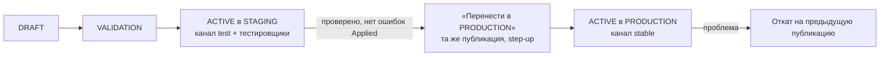

# Окружения и выпуски

## 1. Сейчас [Код][Док]

- Один VPS, одна БД, одно окружение `URALIA_ENV` (dev/test/beta/prod — переменная, но экземпляр один).
- Каналы контента `dev | test | beta | stable` реализованы (`content/service.py`: activate, promote, kill switch,
  min_client), **но выпущенные APK слушают `dev`** (`Config.CHANNEL = "dev"`), поэтому сейчас фактически всё — «prod на
  канале dev».
- Серверные настройки (`server_settings`) — одни на всех.

## 2. Целевая схема [Предложение]

| Окружение | Где | Клиенты | Серверные конфиги | Кто публикует |
|---|---|---|---|---|
| DEVELOPMENT | локально у разработчика (SQLite/Postgres) + CI | эмулятор, Web | свои | разработчик |
| STAGING | **на том же VPS**: канал контента `test` + «теневой» набор серверных конфигов, применяемый только к тестовым аккаунтам (флаг `staging_tester` в профиле) | тестовая сборка APK на канале `test` и Runtime Preview | активации окружения `staging` | Admin, Game Designer, Content Manager, UI Designer |
| PRODUCTION | VPS, канал `stable` | все игроки | активации `production` | Super Admin / Admin со step-up |

Почему staging «теневой», а не второй стек: 2 ГБ RAM на VPS, общий с другими проектами [Док] — второй Postgres+API
не помещается. Теневой режим: игровой код читает конфиг через `registry.active(config_id, env)`, где `env` =
`staging` для игроков с флагом тестировщика, иначе `production`. Ограничение: серверные конфиги, влияющие на общие
сущности (мировые события, рейтинги), в staging проверяются только на тестовых данных/симуляции. Полноценный
отдельный staging — когда появится второй сервер (OPEN_QUESTIONS Q-E1).

## 3. Перенос проверенного

- Переносится **та же неизменяемая публикация** (те же sha256) — ничего не пересобирается (для клиентских пакетов —
  существующая функция `promote(src, dst)` [Код]).
- Публикация с ассетами/данными, помеченными «тестовые», в PRODUCTION блокируется валидатором.
- Защищённое окружение (`protected=true` у production): только права `activate:production`, step-up, подтверждение
  текстом (название окружения).

## 4. Выпуски клиента

- Существующий механизм: `release` (версия, min_version, заметки, файл APK в `/downloads`) + окно «Вышло обновление»
  [Код]. В Studio — раздел «Выпуски» с теми же данными и step-up для `min_version` (принудительное обновление).
- Новая prod-сборка клиента должна получить канал `stable` из настроек экспорта (GODOT_INTEGRATION §2.7).
  **Переход каналов — отдельное решение** (OPEN_QUESTIONS Q-E2): при смене канала текущие игроки на APK с `dev`
  продолжают получать `dev`, поэтому на время перехода оба канала держат одинаковые активные публикации.

## 5. Откат

Серверные конфиги — активация предыдущей публикации (секунды; кэши инвалидируются через Redis). Клиентские — новый
манифест канала со старыми пакетами (как `activate(channel, version)` [Код]); клиенты применят при следующей проверке
(до 15 мин, или сразу при запуске). Аварийно — kill switch контента [Код] возвращает клиентов к встроенным данным.
