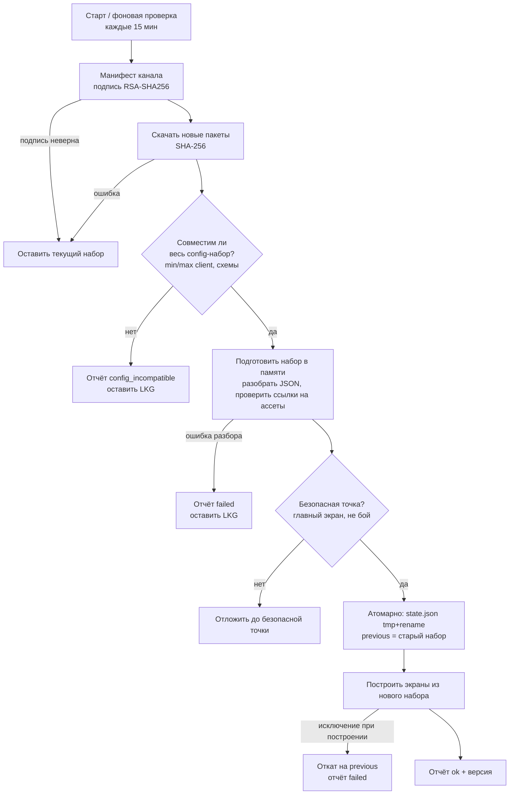

# Интеграция с клиентом Godot

## 1. Что уже есть и используем [Код]

| Нужно | Уже есть | Где |
|---|---|---|
| Получение данных без нового APK | подписанный манифест + пакеты | `client/src/content/Content.gd`, `server/app/content/*` |
| Проверка контрольных сумм | SHA-256 каждого пакета | `Content._validate_zip`, `Downloader.gd` |
| Атомарное применение | state.json через tmp+rename, mount набора | `Content.apply_pending`, `_mount` |
| Последняя рабочая версия | `previous` набор, `rollback()` | `Content.gd` |
| Работа без сети | кэш пакетов в `user://content/` | `Content.gd` |
| Проверка версии клиента | `min_client_version` пакетов, `client_update_required` | `Content.check()` |
| Отчёт о применении | `/content/verify-install` → `content_installations` | сервер `modules/content.py` |
| Раскладка меню | `Game.layout`, `ui_part()`, кэш `user://layout.json` | `Game.gd`, `Main.gd`, `HomeScreen.gd`, `MoreScreen.gd` |
| Подмена графики | `UI.art()`, `UI.skin()`, `GameIcon` | `UI.gd`, `GameIcon.gd` |

## 2. Что нужно добавить [Предложение]

1. **ConfigClient** (новый автозагрузчик или часть `Content`): читает из активного набора пакет kind `config`
   (`config/manifest.json` со списком конфигов, версиями, `schema`, `min_client/max_client`, sha256 каждого
   документа), проверяет совместимость **всего** набора, только затем публикует его в `Game`/`UI` (атомарно).
2. **Тема в рантайме**: константы `UI.gd` (`GOLD`, `TEAL`, `SP`, `FS`, `R`…) → статические переменные с текущими
   значениями по умолчанию; `UI.apply_theme(doc)` до построения первого экрана. Затрагивает все места, где
   константы используются в `const`-выражениях (их придётся сделать `var`). Это самая «широкая» правка клиента.
3. **UIRuntime**: `UIRuntime.build(doc, ctx) -> Control` по каталогу компонентов (UI_EDITOR_ARCHITECTURE §4);
   реестр привязок `bind` (данные `Game`, бейджи `Main.badges`) и действий (`Main.do_action` [Код]).
4. **Перевод экранов на схему** по волнам (UI_EDITOR §8); каждый экран сохраняет встроенный код как запасной.
5. **Preview-режим**: параметр запуска (`?preview=` в Web, deep link `uralia://preview` в APK) → загрузка
   preview-бандла только в память, плашка «ПРЕДПРОСМОТР», без записи в state.json.
6. **Отчёт Applied** с версией config-набора и списком деградаций (`ui_degraded`, `config_incompatible`).
7. **Канал** — сейчас `Config.CHANNEL = "dev"` зашит [Код]; нужен канал из настроек сборки (prod-сборка →
   `stable`), см. ENVIRONMENTS.
8. **Локализация** (если нужна): `tr()`-ключи вместо строк, тексты — конфиг `l10n.*` (отдельная большая волна).

## 3. Поток применения конфигурации

Правила:
- Частичное применение запрещено: либо весь набор, либо ничего (как сейчас для пакетов [Код]).
- Серверные конфиги клиенту не нужны (сервер авторитетен); клиент получает только то, что влияет на отображение.
- Ошибка построения одного экрана → этот экран из LKG/встроенного кода, остальное — новое; плюс отчёт.
- Нет сети → последний применённый набор; первый запуск без сети → встроенные значения APK.

## 4. Оценка работ в клиенте

| Работа | Сложность | Риск |
|---|---|---|
| ConfigClient поверх Content | средняя | низкий (механизмы есть) |
| Тема в рантайме (константы → переменные) | средняя | средний: правки по всем файлам UI |
| UIRuntime + каталог компонентов | высокая | средний |
| Перевод экранов (3 волны) | высокая (по экрану — малая) | низкий по отдельности |
| Preview-режим | средняя | низкий |
| Канал сборки | низкая | низкий |
| Локализация | высокая | средний |
