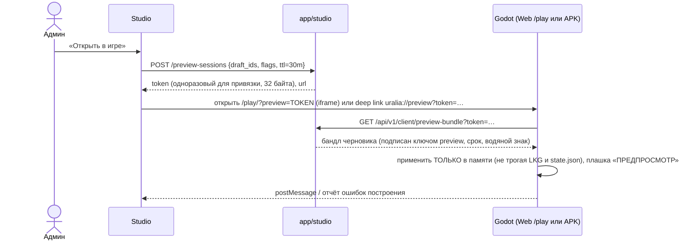

# Система предпросмотра [Предложение]

## 1. Три уровня — и честные названия

| Уровень | Что это | Где | Чем НЕ является |
|---|---|---|---|
| **Static Preview** | DOM-рендер UI Document в Studio с моковыми данными | Studio (телефон/браузер) | Не игра: шрифты/скины/шейдеры приближённые |
| **Interactive Preview** | Тот же рендер + переходы по кнопкам, переключение состояний (загрузка, пусто, ошибка, длинный текст, нет картинки), разные данные | Studio | Не проверяет игровую логику и производительность |
| **Game Runtime Preview** | Настоящий клиент Godot загружает черновой бандл по preview-токену | Godot Web (`/play`) во встроенном окне Studio **или** Android-клиент (тестовая сборка / основной APK в режиме preview) | — это и есть реальная проверка |

В интерфейсе Studio каждый режим подписан: «Макет (приближённо)», «Интерактивный макет», «Игра (реальный клиент)».

## 2. Матрица проверок

| Требование | Static | Interactive | Runtime |
|---|---|---|---|
| Разрешения (720×1280, 1080×1920, 1080×2400, 1440×3200), планшет 1600×2560 | ✅ рамки устройств | ✅ | ✅ (размер окна / устройство) |
| Соотношения сторон 16:9 … 21:9 | ✅ | ✅ | ✅ |
| Ориентация | только портрет [Код: `orientation=1`] | — | — |
| Состояния UI (нормальное, нажато, выключено) | ✅ | ✅ | ✅ |
| Длинные тексты | ✅ генератор «×2 длины» | ✅ | ✅ (флаг preview) |
| Локализации | ⏳ когда будет l10n | ⏳ | ⏳ |
| Нет изображения | ✅ подмена плейсхолдером | ✅ | ✅ (флаг «без ассетов») |
| Загрузка / ошибка загрузки ресурсов | ✅ `Skeleton`/`EmptyState` | ✅ | ✅ (флаг «медленная сеть») |
| ui_scale 0.9/1.0/1.1, крупный шрифт, контраст | ✅ | ✅ | ✅ |

## 3. Runtime Preview — устройство

Правила:
- Preview-бандл **никогда** не пишется в кэш активной конфигурации клиента и не влияет на других игроков.
- Серверные конфиги в Runtime Preview: только **клиентская часть** черновика применяется; серверные числа
  (баланс, награды) показываются как «будет после публикации» — реальное серверное поведение проверяется в
  STAGING (ENVIRONMENTS), а не в preview (иначе пришлось бы держать второй экземпляр логики).
- Токен: TTL 30 мин, привязан к админу, отзыв при выходе; эндпоинт отдаёт только данные черновика.
- Web-экспорт тяжёлый (~30–40 МБ [Док: docs/ui/build.md]) → предупреждение о мобильном трафике, кэш браузера.

## 4. Сравнение с текущей версией

Режим «До / После»: два превью рядом (или переключатель) — активная версия и черновик; подсветка изменённых
узлов дерева; текстовый diff документа (VERSION_MANAGEMENT §3).

## 5. Ограничения производительности

Static/Interactive рендерят только текущий экран; изображения — миниатюры из медиатеки (сервер генерирует
превью при загрузке); GLB — `model-viewer` по требованию (не автозапуск в списках).
