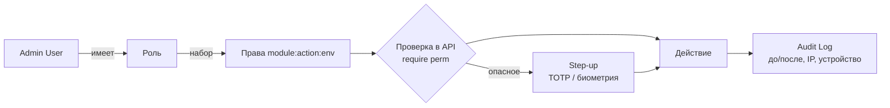

# Модель безопасности

## 1. Сейчас [Код]

- Вход в админку — один общий токен `URALIA_ADMIN_TOKEN` (`X-Admin-Token`, `hmac.compare_digest`), имя —
  самозаявленное `X-Admin-Name` (журнал можно подписать чужим именем). Лимит 60 запросов/мин на IP.
- Токен хранится в `sessionStorage` браузера (или `localStorage` при «Запомнить вход»).
- Транспорт — HTTP без TLS (`http://IP:8000`) [Док: DEPLOY_VPS] → токен идёт открытым текстом.
- Нет ролей, нет индивидуальных учёток, нет отзыва отдельного доступа (только смена общего токена).
- Хорошее: аудит действий (`admin_actions`), ключи LLM не возвращаются в API (маскируются), секретов в APK нет,
  загрузки проверяются по сигнатурам, ZIP-патчи — только данные.

## 2. Целевая модель [Предложение]

1. **TLS обязательно** до запуска Studio: обратный прокси (Caddy — автоматические сертификаты) перед `api`.
   Без домена — минимум самоподписанный сертификат с закреплением в APK. Это **предварительное условие**.
2. **Учётные записи админов** (`admin_users`): логин, хеш пароля (тот же механизм, что у игроков в
   `core/security.py`), обязательный TOTP для ролей с публикацией в PRODUCTION, статус (active/locked).
3. **Сессии**: access JWT 15 мин (отдельный секрет и `aud=studio`, чтобы игровой токен не подходил), refresh 30 дней
   с ротацией и отзывом (`admin_sessions`: устройство, IP, последний вход). В APK refresh хранится в Android
   Keystore (Capacitor secure storage), в браузере — httpOnly cookie `SameSite=Strict` + CSRF-заголовок.
4. **Роли и права** (RBAC): права — строки `module:action[:env]`.
5. **Step-up**: опасные операции требуют повторного подтверждения (TOTP/пароль/биометрия в APK) не старше 5 мин.
6. **Ограничение запросов**: существующий `ratelimit` (Redis) — вход 5/мин на логин+IP, API 120/мин на сессию,
   загрузки 20/мин.
7. **Аварийный вход**: старый `URALIA_ADMIN_TOKEN` остаётся как break-glass Super Admin (только с TLS, каждое
   использование — алерт в журнале), выключаемый переменной окружения после перехода.

## 3. Роли (по реальным разделам проекта)

| Право \ Роль | Super Admin | Admin | Game Designer | Content Manager | UI Designer | AI Operator* | Moderator* | Analyst | Viewer |
|---|---|---|---|---|---|---|---|---|---|
| Просмотр всего | ✅ | ✅ | ✅ | ✅ | ✅ | ✅ | ✅ | ✅ | ✅ |
| Баланс, экономика, кампания (черновики) | ✅ | ✅ | ✅ | — | — | — | — | — | — |
| Герои/контент/ассеты (черновики) | ✅ | ✅ | ✅ | ✅ | — | — | — | — | — |
| Интерфейс и тема (черновики) | ✅ | ✅ | — | — | ✅ | — | — | — | — |
| ИИ-жители (настройки) | ✅ | ✅ | — | — | — | ✅ | — | — | — |
| Модерация (баны, апелляции, чат) | ✅ | ✅ | — | — | — | — | ✅ | — | — |
| ZIP-патчи (загрузка как черновик) | ✅ | ✅ | ✅ | ✅ | ✅ | ✅ | — | — | — |
| Утверждение (APPROVAL) | ✅ | ✅ | — | — | — | — | — | — | — |
| Активация DEV/STAGING | ✅ | ✅ | ✅ | ✅ | ✅ | ✅ | — | — | — |
| Активация и откат PRODUCTION | ✅ | ✅ (step-up) | — | — | — | — | — | — | — |
| Магазин и цены | ✅ | ✅ (step-up) | — | — | — | — | — | — | — |
| Рассылки всем, выпуск APK | ✅ | ✅ (step-up) | — | — | — | — | — | — | — |
| Пользователи и роли, аварийные ключи, LLM-ключи | ✅ (step-up) | — | — | — | — | — | — | — | — |
| Аналитика и мониторинг | ✅ | ✅ | ✅ | ✅ | ✅ | ✅ | ✅ | ✅ | ✅ (без PII) |

\* Роли AI Operator и Moderator добавлены по результатам аудита: в проекте есть большие самостоятельные разделы
ИИ-жителей и модерации [Код].

## 4. Опасные операции (step-up + подтверждение текстом)

Активация/откат в PRODUCTION; изменение цен; рассылка всем; бан/разбан массово; удаление ассетов; изменение ролей;
смена режима платежей (вне Studio — только env); импорт ZIP-патча сразу в PRODUCTION; выпуск обязательного обновления
клиента (`min_version`).

## 5. Прочее

- Проверка файлов: сигнатуры, лимиты, ZIP-лимиты (как в `patches.read` [Код]), запрет путей `..`.
- Защита от повторной публикации: Idempotency-Key + ключ `(changeset, env)`.
- Аудит: неизменяемая таблица, экспорт; хранение бессрочно.
- Данные игроков в Studio: минимум PII (ник, ID); почта игроков — только роли Super Admin/Admin.
- Секреты (LLM-ключи) — только запись, никогда не отдаются клиенту Studio (уже так [Код: `masked_keys`]).
