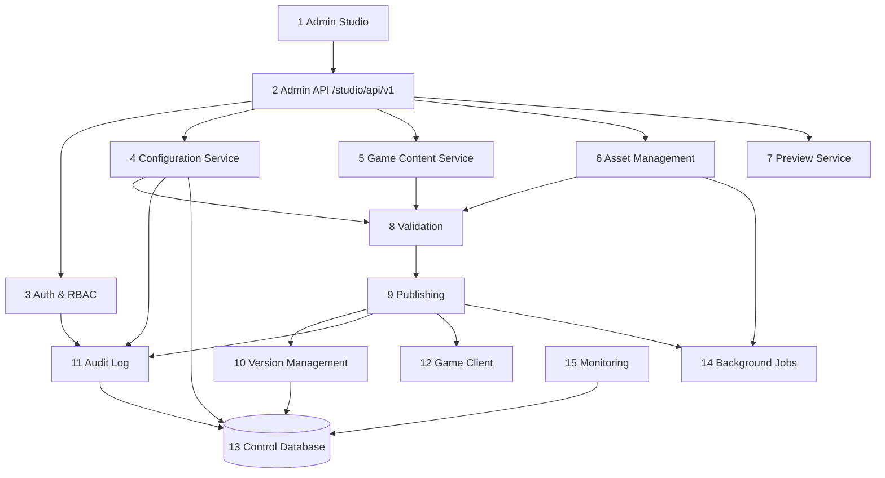

# Компоненты системы [Предложение, с привязкой к существующему коду]

Принцип: один новый модуль `server/app/studio/` внутри существующего FastAPI. Отдельных сервисов нет.

| # | Компонент | Назначение / ответственность | Вход | Выход | Интерфейсы | Зависимости | Ошибки |
|---|---|---|---|---|---|---|---|
| 1 | **Admin Studio** (React, APK/браузер) | Редакторы, предпросмотр, согласование, история, мониторинг | Действия админа | HTTP-запросы | REST JSON (OpenAPI), WebView для Runtime Preview | 2 | Офлайн-баннер, автосохранение черновика локально, повтор с тем же Idempotency-Key |
| 2 | **Admin API** | Единая точка `/studio/api/v1`, схемы pydantic, версия API, лимиты | HTTP | JSON | OpenAPI 3.1 (генерируется FastAPI) | 3–11 | Единый формат ошибок (API_CONTRACTS §2), 409 при конфликте версий, 422 при валидации |
| 3 | **Auth & RBAC** | Вход, сессии, роли/права, step-up подтверждение | логин/пароль(+TOTP), refresh | access JWT, refresh | `/auth/*`, зависимость `require(perm)` | `core/security.py` (переиспользовать хеширование и JWT) | 401/403, блокировка после N ошибок, аудит входов |
| 4 | **Configuration Service** | Реестр модулей и конфигов, черновики, схемы, слияние частичных обновлений | правки (JSON Patch / полный документ) | версии | `/configs/*`, `/drafts/*` | 8, 10, 13; адаптеры к `server_settings`, `game_overrides`, `game/content/*.json` | 409 (ETag), 422 (схема), запрет записи в чужой модуль |
| 5 | **Game Content Service** | Игровые сущности (герои, этапы, предметы, события, магазин) как типизированные коллекции конфигов | CRUD сущностей | черновики конфигов | `/content/{collection}` | 4; существующие `game_editor/*`, `monetization/catalog` | Проверка ссылок (герой в пуле призыва существует и т.д.) |
| 6 | **Asset Management** | Медиатека: загрузка, проверка, версии, связи, поиск неиспользуемых | файлы | asset versions (sha256) | `/assets/*` | `content/store.py` (хранилище по SHA-256), `admin_web/art.py` (проверки PNG/JPEG/GLB) | Отказ формата/размера, карантин подозрительных файлов |
| 7 | **Preview Service** | Сессии предпросмотра черновика: токен, срок, набор версий | draft ids | preview token, бандл | `/preview/*`, `/api/v1/client/preview-bundle` | 4, 5, 6 | Истёкший токен → 410; несовместимость клиента → отчёт |
| 8 | **Validation** | Схемы, типы, диапазоны, ссылки, зависимости, совместимость клиентов, ассеты, UI-компоненты | набор версий | ValidationReport (errors/warnings) | `/validate`, внутренний вызов | 4–6, 10 | Отчёт сохраняется; тяжёлые проверки — фоновой задачей |
| 9 | **Publishing** | Approval, создание неизменяемых версий, сборка config-пакета, активация по окружению, откат | approved changeset | Publication, манифест | `/publications/*` | `content/service.py` (manifest, activate, promote, kill switch), 10, 14 | Идемпотентность (ключ = changeset+env), FAILED с причиной, повтор |
| 10 | **Version Management** | История, diff, восстановление, ветки черновиков, блокировки | ids версий | diff, новые черновики | `/versions/*`, `/diff` | 13 | Защита от изменения опубликованного (только INSERT) |
| 11 | **Audit Log** | Неизменяемый журнал действий админов (кто, что, до/после, IP, устройство) | события | записи | `/audit` (чтение) | расширение `admin_actions` | Запись в той же транзакции, что и действие |
| 12 | **URALIA Game Client** | Получение, проверка, атомарное применение, LKG, отчёт | манифест, пакеты, серверные ответы | отчёт Applied | `/api/v1/content/*`, `/api/v1/client/*` | `Content.gd`, новый `ConfigClient`, `UIRuntime` | Откат на LKG, лог ошибки, отчёт `failed` |
| 13 | **URALIA Control Database** | Таблицы Studio в существующем PostgreSQL | — | — | SQLAlchemy | Alembic | Миграции только аддитивные |
| 14 | **Background Jobs** | Сборка пакетов, проверка ассетов, миниатюры, очистка, повторы активации | задачи | результаты | таблица `studio_jobs` + существующий планировщик | `social/scheduler.py` | Лизинг, повторы с backoff, отметка FAILED |
| 15 | **Monitoring & Logging** | Состояние API/БД/Director, активные версии, Applied по клиентам, ошибки применения, неудачные публикации | существующие таблицы | дашборд | `/monitoring/*` | `job_runs`, `content_installations`, `ai_director_status`, `/health` | Реальные данные помечены, демо — запрещены (см. PERFORMANCE §6) |

## Что остаётся как есть

- Игровое API `/api/v1/*` — без изменений контрактов (добавляются только новые клиентские эндпоинты конфигов).
- Существующая `/admin` продолжает работать до полного переноса функций в Studio (параллельная эксплуатация).
- `ai-director` остаётся отдельным процессом; читает активные версии AI-конфигов из БД.
