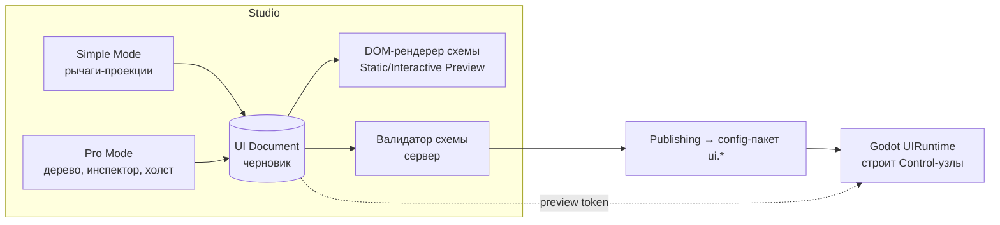

# Архитектура визуального редактора (HYBRID: Simple + Pro)

## 1. Отправная точка [Код]

- Интерфейс игры строится кодом: экраны `client/src/screens/*.gd` вызывают функции `UI.gd` (`UI.card`, `UI.button`,
  `UI.tile`…), контейнеры Godot (`VBoxContainer`, `HBoxContainer`, `GridContainer`, `ScrollContainer`,
  `PanelContainer`, `MarginContainer`). Свободного позиционирования почти нет — раскладка контейнерная.
- Тема — константы в `UI.gd` (`BG`, `SURFACE`, `GOLD`, `TEAL`, `TEXT`, `MUTED`, `SP` отступы, `FS` размеры шрифтов,
  `R` радиусы), плюс скины из графики (`UI.skin(base, "ui/…png", …)`).
- Уже данные-управляемы (с 0.7.7): нижняя панель, главный экран (блоки, колонки, большие кнопки), «Ещё»
  (`server/app/game_editor/layout.py`, `Game.ui_part`). Это **v1** — простая модель «списки кнопок».
- Виртуальное разрешение 1080×1920, `canvas_items` + `expand`, портрет.

Вывод: редактор должен порождать **схему, которую интерпретирует фиксированный код Godot**, а не картинку.

## 2. Единая модель данных: UI Document

Один формат для Simple и Pro. Simple-режим — это набор «рычагов» поверх того же документа.

```json
{
  "schema": "uralia.ui/2",
  "screen": "home",
  "min_client": "0.9.0",
  "theme_ref": "ui.theme@active",
  "root": {
    "id": "root", "type": "VBox", "props": {"separation": "sp.s", "padding": ["sp.s","sp.s","sp.s","sp.s"]},
    "children": [
      {"id": "campaign_strip", "type": "Slot", "props": {"slot": "home.campaign_strip"}, "locked": true},
      {"id": "mid", "type": "HBox", "props": {"expand_v": true}, "children": [
        {"id": "left", "type": "VBox", "props": {"width": 150, "align": "center"},
         "children": [{"id": "b_quests", "type": "SideButton", "bind": {"action": "open:quests", "badge": "quests.claimable"},
                       "props": {"label": "Задания", "icon": "quests"}}]},
        {"id": "squad", "type": "Slot", "props": {"slot": "home.squad"}, "locked": true}
      ]},
      {"id": "actions", "type": "HBox", "children": [
        {"id": "a_shop", "type": "BigButton", "bind": {"action": "open:shop"},
         "props": {"label": "Магазин", "icon": "shop", "bg": "#1d4f8a", "ratio": 1}}
      ]}
    ]
  }
}
```

Ключевые понятия:
- **type** — только из каталога компонентов (§4). Неизвестный тип → валидатор блокирует; клиент пропускает узел.
- **props** — только объявленные для типа свойства (§5), значения — литералы или **токены темы** (`sp.s`,
  `color.gold`, `fs.body`).
- **bind** — привязка к данным/действиям из **реестра, известного коду** (`action: open:<screen>`,
  `badge: quests.claimable`, `text: wallet.gold`). Никаких выражений и скриптов.
- **Slot** — место, где код вставляет сложный, ещё не схемный блок (отряд, карта, бой). Слоты можно
  переставлять/скрывать (если не `required`), но не менять их внутренности. Это механизм **постепенного переноса**.
- **locked / required** — защита обязательных элементов (навигация, кнопки покупки, юридические тексты).

## 3. Режимы

### 3.1 Simple Mode (телефон)
- Список экранов → карточки «что можно поменять»: тема (готовые пресеты + основные цвета), фон экрана, иконки,
  подписи, видимость/порядок элементов, размер шрифта (S/M/L), прозрачность панелей, отступы (компактно/обычно/
  просторно), «Вернуть как было» (сброс к активной версии или к default).
- Реализация: каждое поле Simple — это **проекция** на свойства документа (`theme.colors.gold`,
  `node(a_shop).props.bg`, `root.props.separation`). Изменения пишутся в тот же черновик.

### 3.2 Pro Mode (планшет/ПК, на телефоне — с ограничениями)
Панели: Экраны · Холст · Дерево элементов (Component Tree) · Слои (z-порядок в пределах родителя) · Инспектор
свойств · Медиатека (Asset Browser) · Предпросмотр устройств.
Функции: сетка, направляющие, выравнивание, привязка (snapping) — для узлов в режиме `Free` (якоря);
Undo/Redo (история команд в Zustand, 200 шагов); Copy/Paste/Duplicate (с новыми id); Group/Ungroup (обернуть в
`VBox/HBox/Panel`); Lock/Unlock; Visibility; пресеты компонентов (сохранённые фрагменты документа);
адаптивные правила.



## 4. Каталог компонентов (совместим с `UI.gd`) [Предложение на основе кода]

| Компонент схемы | Godot-реализация [Код] | Назначение |
|---|---|---|
| `VBox`, `HBox`, `Grid`, `Margin`, `Center`, `Scroll` | `VBoxContainer`, `HBoxContainer`, `GridContainer`, `MarginContainer`, `CenterContainer`, `UI.scroll` | Раскладка |
| `Free` | `Control` + якоря/смещения | Свободное позиционирование (Pro) |
| `Panel` (варианты card / glass / solid) | `UI.card`, `UI.glass_panel`, `UI.solid_panel` | Контейнер с фоном |
| `Label`, `Title`, `Section` | `UI.label`, `UI.title`, `UI.section` | Тексты |
| `Button` (варианты primary/glass/danger…) | `UI.button` | Кнопка с действием |
| `IconButton`, `SideButton`, `BigButton`, `Tile` | `UI.icon_button`, `HomeScreen._side`, `HomeScreen._big`, `UI.tile` | Кнопки меню |
| `Icon` | `GameIcon` (kind + замена PNG) | Иконки |
| `Image` | `TextureRect` + `UI.art` | Картинки из медиатеки |
| `ResourceChip` | `UI.chip` | Валюта/ресурс |
| `Badge` | `UI.badge` | Счётчик |
| `ProgressBar` | `UI.bar`, `UI.progress` | Прогресс |
| `TabBar` | `UI.tabs` | Вкладки |
| `Stars`, `RarityTag` | `UI.stars`, `UI.rarity_tag` | Атрибуты героя |
| `RewardsRow` | `UI.rewards_row` | Награды |
| `HeroCard` | `client/src/ui/HeroCard.gd` | Карточка героя (данные из bind) |
| `NavigationBar` | `Main._build_nav` | Нижняя панель |
| `Modal`, `Confirm` | `Main.modal`, `UI.confirm` | Диалоги |
| `Tooltip` | Godot `tooltip_text` | Подсказка |
| `Spacer` | `UI.spacer` | Отступ |
| `EmptyState`, `Skeleton` | `UI.state`, `UI.skeleton` | Пустое/загрузка/ошибка |
| `Slot` | код экрана | Нередактируемый блок |
| `ItemCard` | — (предметов нет) | **Появится вместе с системой предметов** |

Добавление компонента = код в Godot (`UIRuntime` + реализация) + схема на сервере + рендер в Studio → релиз клиента.

## 5. Модель свойств

| Группа | Свойства | Godot-соответствие |
|---|---|---|
| Position / Size | `x, y, w, h` (Free), `min_w, min_h`, `expand_h/v`, `ratio` | `position/size`, `custom_minimum_size`, `size_flags_*`, `size_flags_stretch_ratio` |
| Anchors | `anchor_preset` или `anchors[l,t,r,b]`, `offsets` | `set_anchors_preset`, `offset_*` |
| Padding / Margin | `padding[4]`, `margin[4]` (токены `sp.*`) | `MarginContainer` / `theme_constant_override` |
| Alignment / Layout | `align`, `separation`, `columns`, `wrap` | `alignment`, `separation`, `columns` |
| Z-index / порядок | `z`, порядок детей | `z_index`, порядок узлов |
| Opacity / Visibility | `opacity`, `visible`, `visible_if` (флаг/сегмент из реестра) | `modulate.a`, `visible` |
| Background / Border / Radius / Shadow | `bg` (цвет/токен/градиент 2 точки/image), `border{w,color}`, `radius`, `shadow{color,size,offset}` | `StyleBoxFlat` / `StyleBoxTexture` (`UI._flat`, `UI.skin`) |
| Blur | `glass: true/false` (шейдер `glass.gdshader` уже есть) | `material` |
| Typography | `font` (из разрешённых: regular/bold/title), `size` (`fs.*`), `color`, `align`, `wrap`, `max_lines` | `theme_font_*_override` |
| Icon / Image | `icon` (kind), `image` (asset id), `fit` (cover/contain) | `GameIcon.kind`, `TextureRect.stretch_mode` |
| Animation | `enter` (fade/slide/pop из набора), `pulse` | существующие `_enter_anim`, `UI.pop_in` |
| State | `states{normal,hover,pressed,disabled}` — переопределения стилей | stylebox по состояниям кнопки |
| Responsive | `rules[{when: {aspect_lt: 0.5 | width_lt: 900 | ui_scale}, set: {...}}]` | вычисляются при `resized` |

Все значения проходят типизацию по схеме компонента; неизвестное свойство → ошибка валидации.

## 6. Тема

`ui.theme` — отдельный конфиг токенов: цвета (`bg, surface, line, text, muted, gold, gold_dark, teal, ok, bad,
warning`), отступы `sp.*`, шрифты `fs.*`, радиусы `r.*`, пресеты. В Godot константы `UI.gd` превращаются в значения,
загружаемые из темы (с текущими значениями по умолчанию) — **изменение кода клиента** (GODOT_INTEGRATION §4).
Доступность (high_contrast, colorblind) остаётся поверх темы [Код: `UI.high_contrast`, `UI.colorblind`].

## 7. Связь с реальным интерфейсом и восстановление

1. **Описание компонентов** — общий манифест каталога `ui_components.json` (тип, свойства, допустимые дети, версия
   клиента, с которой поддерживается). Его генерирует/проверяет клиентский тест, сервер хранит копию — так Studio
   и Godot не расходятся.
2. **Применение** — `UIRuntime.build(doc, ctx)` строит дерево Control-узлов, подставляя данные `bind` из `Game`.
3. **Совместимость** — документ несёт `min_client`; клиент ниже → берёт встроенный экран (как сейчас v1 без раскладки).
4. **Отсутствующий компонент** — узел заменяется пустым `Control` (или пропускается), в лог + отчёт `ui_degraded`.
5. **Ошибка построения** — экран строится заново из LKG-документа, при повторной ошибке — встроенный код экрана.
   Экран не может «сломаться» до невозможности навигации: `NavigationBar` всегда содержит «Главная» и «Ещё» (как
   в v1 [Код: `Main.nav_items`]).
6. **Ограничения** — никакого исполняемого кода, только `bind` из перечня; действия — из `Main.do_action` [Код].

## 8. Перенос экранов (постепенно)

| Волна | Экраны | Что даёт |
|---|---|---|
| 0 (есть) | nav, home, more — модель v1 | перенос v1 → `uralia.ui/2` автоматически |
| 1 | Тема + Settings, Profile, Mail, Quests | Простые списки, быстрый эффект |
| 2 | Shop, Events, Rankings, Friends | Карточки и вкладки |
| 3 | Heroes (карточки), Guild, Caravan | Сложные привязки данных |
| Слоты навсегда (пока) | Бой, 3D-карты, отряд | Остаются кодом; редактор меняет только окружение |
